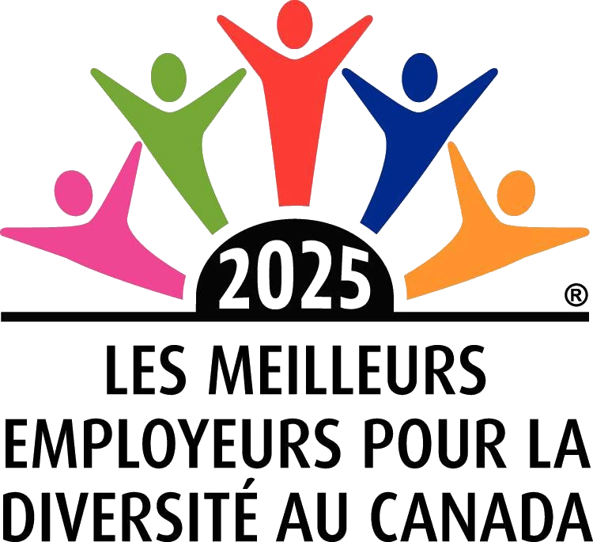
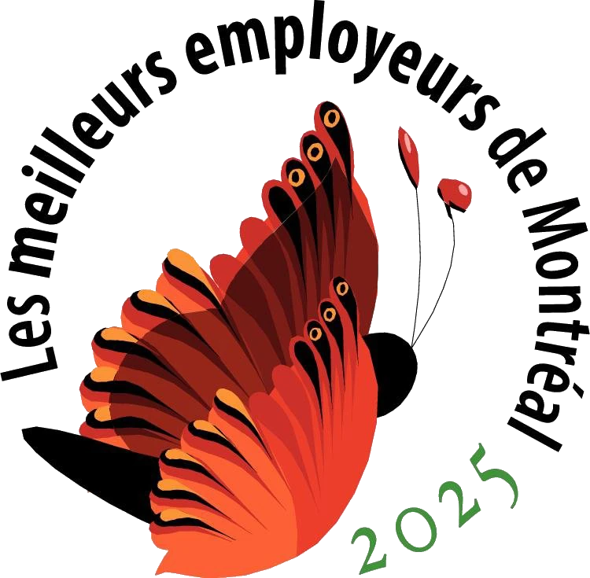

## Carrière

:::cartes
- :icone[users-three] [Notre organisation](/a-propos/notre-organisation/)
- :icone[student] [Membre Premières Nations, Métis ou Inuit?](/a-propos/carriere/affichage-premiers-peuples/)
- :icone[udem] [Faire carrière à l'UdeM](https://www.umontreal.ca/carrieres/)
:::

### Affichage en cours

Aucun poste n'est affiché pour le moment.

### Candidatures spontanées

Pour les postes de commis étudiant ou étudiante (à temps partiel), de technicien ou technicienne en documentation, de bibliothécaire ou de cadre, contactez-nous à l'adresse [cv@bib.umontreal.ca](mailto:cv@bib.umontreal.ca).

:::alerte{titre="À noter"}
Les CV sont conservés pour une période d’un an. Pour tout autre type de poste, nous vous invitons à consulter les pages [Carrières de l'UdeM](https://www.umontreal.ca/carrieres/).
:::

### L’Université de Montréal, un bon employeur

:::logos
- 
- 
- 
:::

Source: [https://www.canadastop100.com/](https://www.canadastop100.com/)
