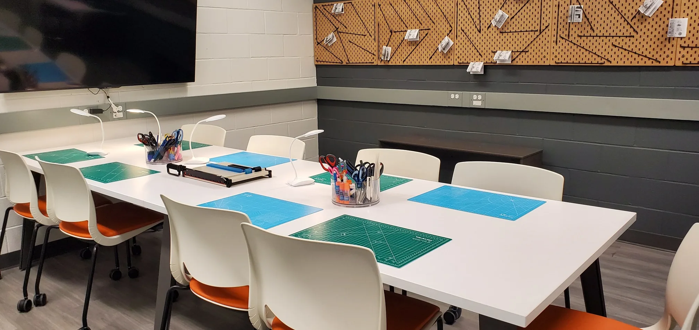

# Directives des pages Markdown

Démonstration de chaque directive des pages de texte (.md) et de chaque valeur d'attribut. Vocabulaire et règles : docs/REDACTION.md. Un deux-points ordinaire reste du texte : voir:ici, 10:30, Note:Important.

## Modalités

:::modalites
- :icone[identification-card] Emprunt avec : carte Bibliothèques UdeM et une pièce d'identité avec photo
- :icone[Books] Nombre maximum de documents : **100 documents**
- :icone[calendar-dots] Durée du prêt : 30 jours ([voir les exceptions](/obtenir/pret-renouvellement-retour/#exceptions-au-renouvellement-automatique))
- :icone[sofia] Icône maison : Sofia
- :icone[burger] Icône maison : menu
:::

Taille et couleur d'icône (description des icônes d'accessibilite-web) :

:::modalites
- :icone[burger]{taille=40 couleur=neutre700} Ouvrir le menu du site
- :icone[magnifying-glass]{taille=40} Rechercher
- :icone[lien-interne]{taille=50} Suivre le lien à l'intérieur du site
- :icone[lien-externe]{taille=50} Suivre le lien qui mène à un autre site
:::

## Alertes

:::alerte
Sans attribut : type info.
:::

:::alerte{type=succes titre="Inscription confirmée"}
Avec un titre. Le texte peut contenir des [liens](/horaires/) et du **gras**.
:::

:::alerte{type=attention}
Attention : le comptoir ferme plus tôt cette semaine.
:::

:::alerte{type=erreur}
Le service est interrompu.
:::

## Boutons

::bouton[Bouton principal]{lien=/horaires/}

::bouton[Bouton secondaire]{lien=/horaires/ type=secondaire}

::bouton[Lien externe]{lien=https://www.umontreal.ca}

::bouton[Document PDF]{lien=/nous-soutenir/politique-dons-2025-adoptee.pdf}

Un paragraphe après les boutons garde son espace. Un lien du texte vers un [document PDF](/nous-soutenir/politique-dons-2025-adoptee.pdf) reçoit l'icône et l'annonce « PDF » ; un [courriel](mailto:bibliotheques@umontreal.ca) reste un lien ordinaire.

::bouton[Bouton centré]{lien=/enseignement/formulaire-reserve/ alignement=centre}

## Tableaux

Un tableau sans nom (la zone défilante s'appelle « Tableau ») :

| Type de document | Durée du prêt |
| --- | ---: |
| Livres | 30 jours |
| Périodiques | 7 jours |

:::tableau{titre="Durée du prêt par type de document"}
| Type de document | Durée du prêt |
| --- | ---: |
| Livres, partitions | 30 jours |
| Réserve de cours | Livres 3 heures Audiovisuel : 6 heures |
:::

## Sections de couleur

:::section{fond=bleu100}
### Fond clair

Texte et [lien](/horaires/) sur bleu 100.
:::

:::section{fond=vertFonce #ancre-demo}
### Fond foncé, avec ancre

Texte et [lien](/horaires/) sur vert foncé : le lien passe en blanc.

::bouton[Bouton dans une section]{lien=/horaires/}
:::

## Image

Une image Markdown est optimisée par Astro (formats et tailles), y compris dans une directive.

:::alerte{type=info titre="Image dans une alerte"}

:::

## Cartes

Cartes à icône (Card2) :

:::cartes
- :icone[users-three] [Notre organisation](/a-propos/notre-organisation/)
- :icone[student] [Membre Premières Nations, Métis ou Inuit?](/a-propos/carriere/affichage-premiers-peuples/)
- :icone[udem] [Faire carrière à l'UdeM](https://www.umontreal.ca/carrieres/)
:::

Cartes à icône avec texte d'appel et couleur (CardWithIcon) :

:::cartes{couleur=vertFonce}
- :icone[pencil-simple] [Rédiger un plan de gestion de données](https://boite-outils.bib.umontreal.ca/) Voir le guide
- :icone[books] [Emprunter un document](/obtenir/pret-renouvellement-retour/) En savoir plus
:::

Cartes à image (CardWithImage) :

:::cartes
-  [Atelier de zines](/engagements/) Découvrir l'atelier
-  [Collection Claude-Gingras](https://claude-gingras.bib.umontreal.ca/)
:::

## Liens

:::liens
- [Sources primaires pour la recherche en histoire](https://kerko.bib.umontreal.ca/sources-primaires-histoire/)
  Base de données pour repérer des sources primaires utiles pour les travaux étudiants en histoire.
- [Horaires des bibliothèques](/horaires/)
:::

## Image et texte

:::image-texte

### Image à droite (par défaut)

Le texte peut contenir des **paragraphes**, des listes et des [liens](/horaires/).

::bouton[Bouton dans le pied]{lien=/horaires/}
:::

:::image-texte{position=gauche}

### Image à gauche

Sur un téléphone, l'image passe au-dessus du texte.
:::

## Citation

:::citation{source="Dr Gilles Théorêt, diplômé de l’Université de Montréal"}
L’histoire peut se perdre ou être déformée par le temps. Il est important d’avoir des sources de première main pour la comprendre.
:::

## Accordéon

::::accordeon
### Partenaire de la recherche

S’inscrire comme partenaire à part entière de la recherche.

#### Stratégies

- Enrichir l’offre de services.
- Favoriser le maillage avec tous les acteurs de la recherche.

### Science ouverte

Déployer des services et des outils qui font de la science ouverte une réalité.

### Volet avec image et texte

:::image-texte

1. Repérer le document dans Sofia.
2. Cliquer sur le bouton **Obtenir**.
:::
::::

## Petite image et texte

:::image-texte{taille=petite}

### Petite image à droite

L'image garde une petite hauteur (11rem) et peut avoir une description. Le texte prend le reste de la largeur ; sous 900 px, l'image passe sous le texte.
:::

::::image-texte{taille=petite position=gauche}

:::citation{source="Une personne citée"}
Petite image à gauche, avec une citation.
:::
::::

## Galerie

:::galerie
-  Légende de la première photo
-  Légende de la deuxième photo, *avec de l'italique*
-  Troisième photo
:::

## Logos

:::logos
- 
- 
- 
:::

## Icône et texte

:::icone-texte{icone=target fond=vertPale}
### Notre mission

Du texte à gauche, une grande icône dans un carré de couleur à droite.
:::

:::icone-texte{icone=binoculars}
### Fond par défaut (bleu100)

Texte.
:::

## Encadrés

:::encadres{fond=rose300}
### Passion :icone[heart]

Encadré avec une icône à droite du titre (50 px, rouge orangé par défaut).

### Courage :icone[mountains]{taille=40 couleur=bleuFonce}

Icône réglée.

### Sans icône

Troisième encadré : la rangée suivante commence.
:::

## Séparateur et ancre fixe

Un filet `---`, précédé d'une ligne vide :

---

### Titre avec une ancre fixe {#ancre-fixe-demo}

Ce titre a l'ancre `#ancre-fixe-demo` au lieu de celle que donnerait son texte.

Icône d'accordéon (icône maison `accordeon`) :

:::modalites
- :icone[accordeon]{taille=45 couleur=bleuPrincipal} Déployer ou dissimuler l'élément d'accordéon
:::
