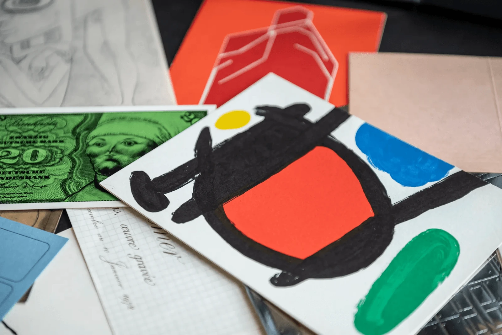
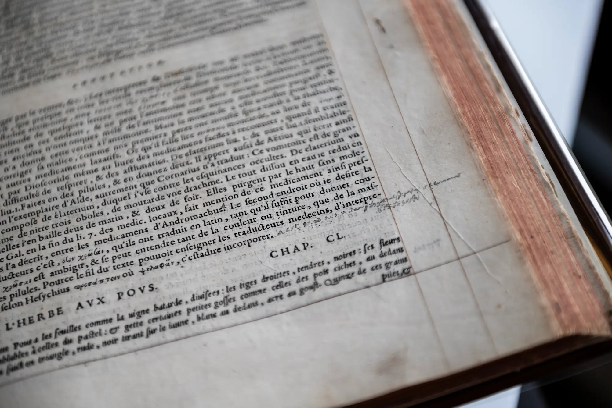
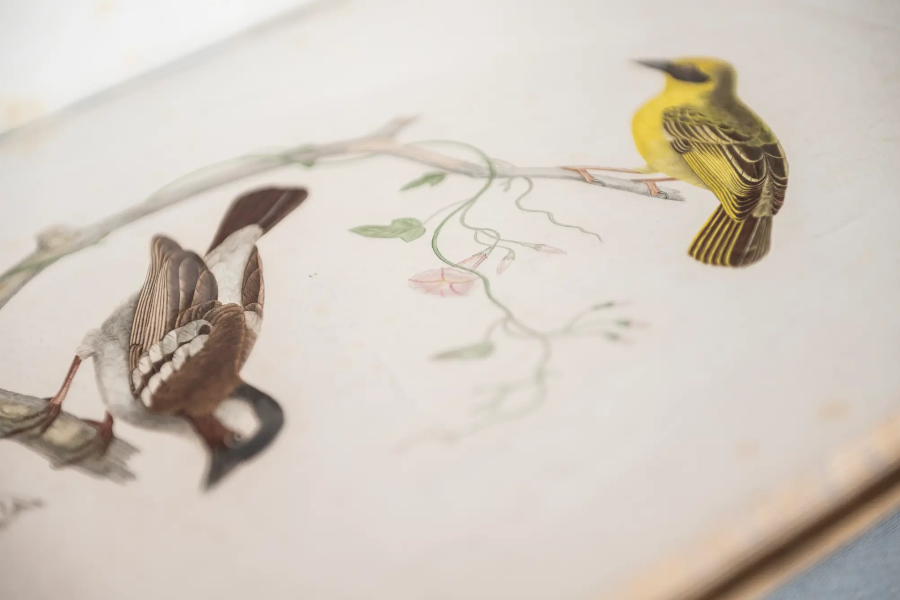
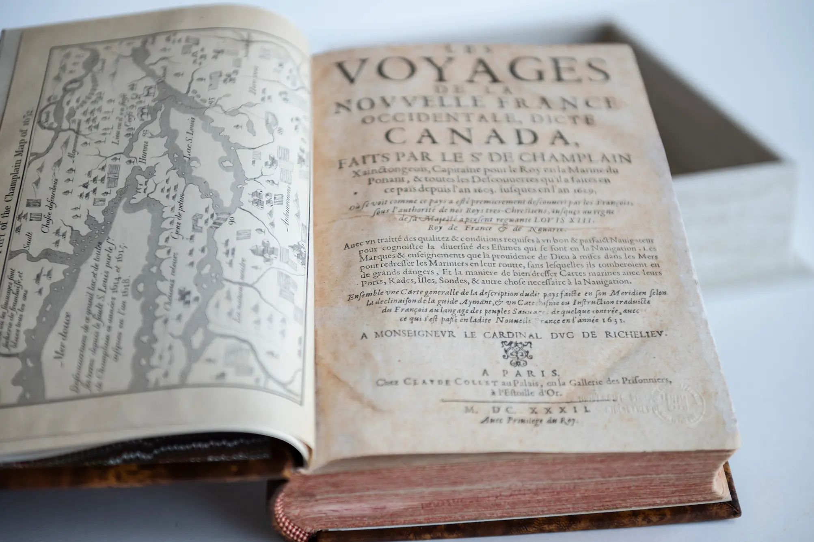

## Soutenez le fonds des livres rares de l’Université de Montréal

### Le trésor des bibliothèques de l'UdeM

Quelque 150 000 documents anciens, rares ou précieux forment les collections spéciales de l’Université de Montréal.

À la Bibliothèque des livres rares et collections spéciales où ils sont conservés, on trouve des tablettes d’argile de 4000 ans d’âge, des manuscrits du Moyen-Âge, des affiches de guerre (et de l’entre-deux-guerres) ou encore des livres imprimés de l’époque de Gutenberg jusqu’à nos jours.

Les documents de notre collection s’inscrivent dans l’histoire mondiale. Saviez-vous que les fabricants des premiers papiers laissaient leur marque en filigrane, et qu’il est possible de retracer ainsi des maîtres papetiers ayant exercé il y a plus de 500 ans? Ou encore, que notre exemplaire des Commentaires de M. Pierre André Matthiole, médecin senois, sur les six livres de Ped. Dioscoride Anazarbeen de la matière médicinale comprend des corrections manuscrites d’un de ses anciens propriétaires, et est donc unique au monde?

Ce ne sont que deux exemples dont nous assurons la conservation. Or, cette conservation comprend des travaux de restauration aussi inévitables que le temps qui passe et l’histoire qui se construit. Compte tenu de la grande quantité d’œuvres et de leur valeur, l’Université de Montréal ne peut pas couvrir l’entièreté des frais de restauration et de conservation de ces pièces uniques.

:::galerie
-  Cartons d'invitation à des vernissages d'expositions
-  Corrections manuscrites d’un ancien propriétaire
-  Illustration animalière dans « Voyage en Abyssinie »
:::

::bouton[Je donne]{lien="https://formulairereseau.umontreal.ca/site/Donation2?df_id=1560&1560.donation=form1&mfc_pref=T&s_locale=fr_CA"}

### Documents exceptionnels à adopter

Votre soutien peut aussi se traduire par une adoption d’un livre ancien. En posant ce geste, vous participerez directement à la restauration complète d’un ouvrage. Une fois restauré, celui-ci sera conservé dans un boîtier protecteur et accompagné d’un certificat d’adoption, témoignant de votre contribution à la préservation de ce patrimoine pour les générations futures.

En 2023-2024, le Dr Gilles Théorêt, diplômé de l’Université de Montréal, a ainsi adopté notre édition datée de 1632 des Voyages de la Nouvelle France occidentale, dicte Canada de Samuel de Champlain. Ce document, une version révisée et augmentée de l’édition de 1613, est considéré comme la plus importante de toutes les éditions de cet ouvrage. La carte géographique qui l’accompagne est la première représentation occidentale de l’entièreté des Grands Lacs.

::::image-texte{taille=petite position=gauche}

:::citation{source="Dr Gilles Théorêt, diplômé de l’Université de Montréal et adoptant de l’ouvrage Les voyages de la Nouvelle France occidentale"}
L’histoire peut se perdre ou être déformée par le temps. Il est important d’avoir des sources de première main pour la comprendre.
:::
::::

### Soutenez notre héritage culturel

Votre participation contribuera à restaurer, protéger et conserver des livres et des affiches d'une valeur inestimable.

Chaque geste de générosité nous aide à soutenir les coûts de travaux, tels que:
- Création d’un boîtier pour un livre ancien – de 400 $ à 500 $;
- Nettoyage d’un livre ancien – entre 800 $ et 1500 $, selon le format;
- Reliure ou restauration d’un livre ancien – jusqu’à 10 000 $;
- Restauration d’une affiche ancienne – entre 1500 $ et 3000 $.

**Chaque don est précieux, tout comme ces livres**. En combinant votre générosité à celle d’autres personnes au grand cœur, nous intensifions notre plan de restauration en fonction des priorités et de la condition des ouvrages pour qu’ils restent accessibles pour les générations futures.

::bouton[Je donne]{lien="https://formulairereseau.umontreal.ca/site/Donation2?df_id=1560&1560.donation=form1&mfc_pref=T&s_locale=fr_CA"}
