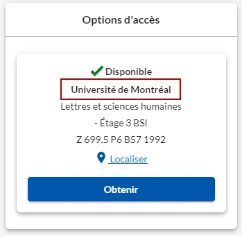
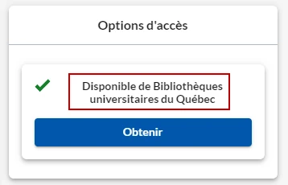
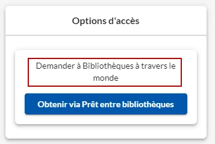

## Demande de numérisation

À la demande, nos équipes se chargent de vous faire parvenir la copie numérisée d'un article ou d'un chapitre de livre imprimé. La procédure pour demander une numérisation d’article ou de chapitre de livre diffère en fonction de l’institution détentrice du document. Cette information se trouve dans la rubrique Options d’accès de la notice du document dans Sofia.

::::accordeon
### Document des Bibliothèques UdeM

:::image-texte{taille=petite}

1. Repérer le document dans Sofia.
2. Cliquer sur le bouton **Obtenir**.
3. Sélectionner **Options de récupération** > **Article ou chapitre numérisé**.
4. Inscrire tout détail nécessaire à votre demande dans le champ **Voulez-vous une édition ou volume précis? Avez-vous d'autres instructions pour cette demande** ;
5. Le lien vers la copie numérisée sera envoyé par courriel.
:::

### Document des bibliothèques universitaires québécoises

:::image-texte{taille=petite}

1. Se connecter au [dossier Sofia](https://umontreal.account.worldcat.org/account).
2. **Créer une demande** en complétant l'un des formulaires disponibles sous les onglets **Article, Livre/chapitre de livre** ou **Autre format**.
3. Le lien vers la copie numérisée sera envoyé par courriel.

Note : ne pas utiliser le bouton Obtenir. Le bouton Obtenir vous permettra de faire venir une version physique du document.
:::

### Document d'une autre bibliothèque à travers le monde

:::image-texte{taille=petite}

1. Repérer le document dans Sofia.
2. Si le document n'est pas disponible à l'UdeM, élargir à **Bibliothèques à travers le monde**.
3. Cliquer sur **Obtenir via Prêt entre bibliothèques**.
4. Sélectionner le Type de service **COPY** et identifier le titre du chapitre ou le titre de l’article ainsi que les pages souhaitées.
5. Le lien vers la copie numérisée sera envoyé par courriel.
:::
::::

### Délais

- Bibliothèques de l'UdeM ou autres bibliothèques universitaires québécoises: 2 à 4 jours ouvrables, à moins que le document ne soit déjà emprunté
- Autres bibliothèques: variable

### Respect du droit d'auteur

La reproduction d’une œuvre protégée par la [Loi canadienne sur le droit d’auteur](https://laws-lois.justice.gc.ca/fra/lois/C-42/index.html) ne peut être utilisée qu'à des fins d’[étude privée ou de recherche](https://laws-lois.justice.gc.ca/fra/lois/C-42/section-30.2.html). Tout usage à d’autres fins exige l’autorisation du titulaire des droits.

Il est possible de reproduire:

- jusqu'à 20% d'un livre (maximum 100 pages)
- un article par numéro de périodique

Toutefois, les enseignants et enseignantes qui souhaitent diffuser une œuvre protégée dans le cadre de leur cours peuvent le faire grâce à la licence Copibec. Pour plus de détails, consulter la page [Déclaration de reproduction (licence Copibec)](https://boite-outils.bib.umontreal.ca/recherche/declaration-reproduction).
