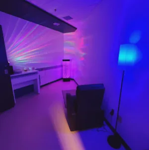

## Service Accessibilité

Les bibliothèques de l’Université de Montréal ont à cœur de fournir des services, des espaces et des collections inclusifs et accessibles à tous les membres de la communauté UdeM, afin de contribuer à leur réussite. Le Service Accessibilité s’assure que vous ayez accès aux ressources et aux services des bibliothèques, quelle que soit votre situation : il offre des locaux adaptés, des logiciels d’accessibilité et du soutien personnalisé.

Avant de limiter votre curiosité selon l’accessibilité des documents, communiquez avec nous!

### Nous joindre

:::modalites
- :icone[map-pin] Bibliothèque des lettres et sciences humaines, pavillon Samuel-Bronfman, 3000, rue Jean-Brillant, 1er étage, salle 1085
- :icone[clock] Locaux ouverts selon les [heures d’ouverture de la bibliothèque](/horaires/#lettres-et-sciences-humaines)
- :icone[user] Bibliothécaire : François Constantin-D’Amour
- :icone[calendar-dots] Disponible du lundi au jeudi, en personne ou à distance, et le vendredi à distance, de 9 h 30 à 17 h 30
- :icone[envelope-simple] Courriel : [accessibilite@bib.umontreal.ca](mailto:accessibilite@bib.umontreal.ca)
- :icone[phone] Téléphone : [514 343-2135](tel:+15143432135)
:::

:::alerte{titre="Mesures d’accommodement"}
Pour les mesures d’accommodement et les autres services de l’Université aux personnes étudiantes en situation de handicap, communiquez avec les [Services aux personnes étudiantes en situation de handicap (SPESH)](https://vieetudiante.umontreal.ca/a-propos/service/soutien-etudiants-situation-handicap).
:::

### Nos services

#### Aide à la recherche de documents dans les collections et accompagnement adapté

Pour obtenir de l’aide pour trouver des livres ou des revues dans Sofia, ou des articles de revues dans les bases de données, consultez le personnel des services de référence des bibliothèques. Pour une aide à la recherche avancée, communiquez avec votre [bibliothécaire disciplinaire](/nous-joindre/notre-equipe/).

Le Service Accessibilité vous accompagne selon vos besoins dans l’exploration du site web des bibliothèques et des outils de recherche, et dans vos recherches de documents. Il peut aussi conseiller votre bibliothécaire disciplinaire pour que votre rencontre soit adaptée à vos besoins particuliers. N’hésitez pas à nous faire part de vos besoins pour que nous puissions nous adapter.

#### Récupération des livres, des revues ou des articles

Les membres de la communauté UdeM peuvent récupérer un document à la bibliothèque UdeM de leur choix. Le document repéré dans Sofia est livré au comptoir de cette bibliothèque, et un avis de disponibilité est envoyé par courriel. Les délais varient selon la provenance du document (une bibliothèque UdeM, une autre bibliothèque universitaire québécoise ou un établissement hors du Québec). Si vous avez besoin d’aide pour remplir le formulaire de réservation, communiquez avec le Service Accessibilité.

Pour emprunter un document, présentez-vous au comptoir de prêt ou à une borne de prêt en libre-service. Aux bibliothèques des Sciences, Médecine vétérinaire et Mathématique et informatique, les bornes sont installées sur une table à hauteur ajustable.

Si un document est difficile à atteindre (tablette trop haute ou trop basse, allée trop étroite), demandez de l’aide au personnel de l’accueil ou du service de référence. À la Bibliothèque des lettres et sciences humaines, vous pouvez aussi vous adresser au Service Accessibilité.

#### Accès à des versions accessibles et à des formats de substitution (service d’adaptation documentaire) {#acces-a-des-versions-accessibles-et-a-des-formats-de-substitution-service-dadaptation-documentaire}

Plusieurs livres et revues des collections des bibliothèques UdeM sont offerts en format numérique et se consultent à partir de Sofia.

Les personnes ayant une déficience perceptuelle au sens de l’[article 2 de la Loi sur le droit d’auteur](https://laws-lois.justice.gc.ca/fra/lois/c-42/page-1.html#h-100033) peuvent communiquer avec le Service Accessibilité, qui les aidera à trouver une version dans un format adapté à leurs besoins. Si aucune version n’existe, le service adapte le document :

- les lectures obligatoires prévues dans les plans de cours;
- les livres que les bibliothèques possèdent ou peuvent acquérir;
- les livres ou articles de revues des collections nécessaires aux travaux de fin de session ou de recherche.

### Logiciels et équipements d’assistance {#acces-a-des-logiciels-et-equipements-dassistance}

Voici les logiciels et équipements offerts actuellement dans les bibliothèques. Si vous avez besoin d’autres logiciels ou équipements, communiquez avec le Service Accessibilité.

:::accordeon
#### Bibliothèque des lettres et sciences humaines

##### Logiciels

Dans les locaux du Service Accessibilité, salle 1085 :

- Adobe Acrobat Pro (création de documents PDF)
- Balabolka (conversion de fichiers texte en fichiers audio, voix de synthèse)
- Dragon NaturallySpeaking (reconnaissance de la voix)
- Duxbury Braille Translator (transcription de textes en braille)
- JAWS (lecteur d’écran)
- OpenBook (conversion de textes imprimés en fichiers audio)
- WordQ (aide à l’écriture avec prédiction de mots et rétroaction vocale, synthèse vocale)
- ZoomText (logiciel d’agrandissement, synthèse vocale)

##### Équipement d’assistance

Dans les locaux du Service Accessibilité, salle 1085 :

- Appareil multifonction accessible (numérisation, photocopie, impression)
- Imprimante braille
- Grand écran incurvé
- Plusieurs postes informatiques avec grands écrans
- Plage tactile braille, qui permet aux personnes non voyantes d’utiliser un poste informatique
- Claviers adaptés
- Tables à hauteur ajustable
- Téléscripteur : clavier pour les communications téléphoniques des personnes malentendantes
- Téléagrandisseur TwinView
- Téléagrandisseur SpeechView
- Vélo-pupitre

#### Bibliothèque Hubert-Reeves

##### Logiciels

Dans la salle de travail individuelle adaptée (local A-1543) et sur le poste adapté en libre-service, près de la zone A-1536 :

- ABBYY FineReader 15 (reconnaissance optique de caractères)
- Balabolka (conversion de fichiers texte en fichiers audio, voix de synthèse)
- Lexibar LP5 (aide à l’écriture avec rétroaction vocale, synthèse vocale)
- Natural Reader (aide à l’écriture avec rétroaction vocale, synthèse vocale)
- ZoomText 2019 (logiciel d’agrandissement, synthèse vocale)

##### Équipement d’assistance

Dans la salle de travail adaptée (local A-1543) :

- Un poste informatique
- Une imprimante ajustable en hauteur
- Un téléagrandisseur ajustable en hauteur
- Une table pliante mobile

#### Bibliothèque Thérèse-Gouin-Décarie (pavillon Marie-Victorin)

##### Logiciels

Poste de travail au 3e étage, près du service de référence :

- ZoomText (logiciel d’agrandissement)

##### Équipement d’assistance

Poste de travail au 3e étage, près du service de référence :

- Téléagrandisseur
- Appareil multifonction accessible (numérisation, photocopie, impression)

#### Bibliothèque du campus Laval

##### Logiciels

- ZoomText

##### Équipement d’assistance

- Poste de travail adapté, avec un grand écran et un bras articulé

#### Bibliothèque de droit

##### Équipement d’assistance

Station ergonomique au 4e étage :

- Table à hauteur ajustable
- Chaise et clavier ergonomiques
- Grand écran ajustable

#### Postes publics des bibliothèques

##### Logiciels

- Adobe Acrobat Pro (création de documents PDF)
:::

### Salles de travail adaptées {#acces-a-des-salles-de-travail-adaptees}

Deux bibliothèques offrent des salles adaptées aux personnes étudiantes en situation de handicap.

::::accordeon
#### Salle adaptée à la Bibliothèque des lettres et des sciences humaines

##### Salles de travail communes

Les salles de travail communes sont accessibles en tout temps dans les locaux du Service Accessibilité, salle 1085, au 1er étage. Elles sont équipées de logiciels et d’équipements d’assistance, et de mobilier accessible.

##### Salle de travail individuelle

Une salle de travail individuelle est réservée aux personnes étudiantes en situation de handicap au local 6111, au 6e étage. Elle est équipée d’une table à hauteur ajustable et d’un tableau blanc accessible. Vous pouvez l’utiliser pendant 4 heures, renouvelables si elle n’est pas réservée. Les personnes accompagnatrices et les chiens d’assistance sont les bienvenus.

Pour vérifier sa disponibilité ou la réserver quelques jours à l’avance :

- téléphonez au [514 343-2655](tel:+15143432655);
- écrivez à [refblsh@bib.umontreal.ca](mailto:refblsh@bib.umontreal.ca);
- présentez-vous à la salle 1085 ou au bureau de référence du 2e étage.

La clé vous est remise en échange de votre adresse courriel UdeM.

##### Salle multisensorielle

:::image-texte{taille=petite}

Cette salle offre un espace de régulation émotionnelle et sensorielle aux personnes étudiantes qui ressentent le besoin de stimuler ou d’apaiser leurs sens. La salle 1085-4, dans les locaux du Service Accessibilité au 1er étage, est ouverte du lundi au vendredi de 9 h 30 à 17 h 30. En libre-service et sans réservation, elle accueille une personne à la fois, pendant 30 minutes, pour que le plus grand nombre puisse en profiter. Une affiche sur la porte permet d’indiquer que la salle est occupée.

Vous y trouverez un fauteuil inclinable avec automassage, des éclairages doux et interactifs (colonne à bulles, projecteur d’images relaxantes, lampe DEL), une ambiance sonore adaptée (machine à bruit blanc avec différents réglages), de l’aromathérapie et de la stimulation tactile (balles antistress).
:::

#### Salle adaptée à la Bibliothèque Hubert-Reeves

La Bibliothèque Hubert-Reeves offre une salle de travail individuelle adaptée aux personnes étudiantes en situation de handicap, au local A-1543. Elle est équipée d’un poste informatique, d’une imprimante et d’un téléagrandisseur ajustable en hauteur. Vous pouvez l’utiliser pendant 4 heures au plus, renouvelables s’il n’y a pas d’autre réservation. Les personnes accompagnatrices et les chiens d’assistance sont les bienvenus.

Pour vérifier sa disponibilité ou la réserver jusqu’à quelques jours à l’avance :

- téléphonez au [514 343-6111, poste 5038](tel:+15143436111,5038);
- écrivez à [prsci@bib.umontreal.ca](mailto:prsci@bib.umontreal.ca);
- présentez-vous au comptoir de service, local A-1546.

La clé vous est remise en échange de votre adresse courriel au comptoir de service.
::::
